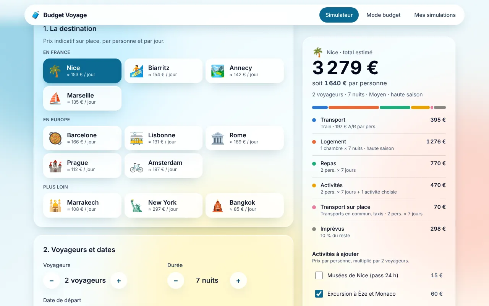
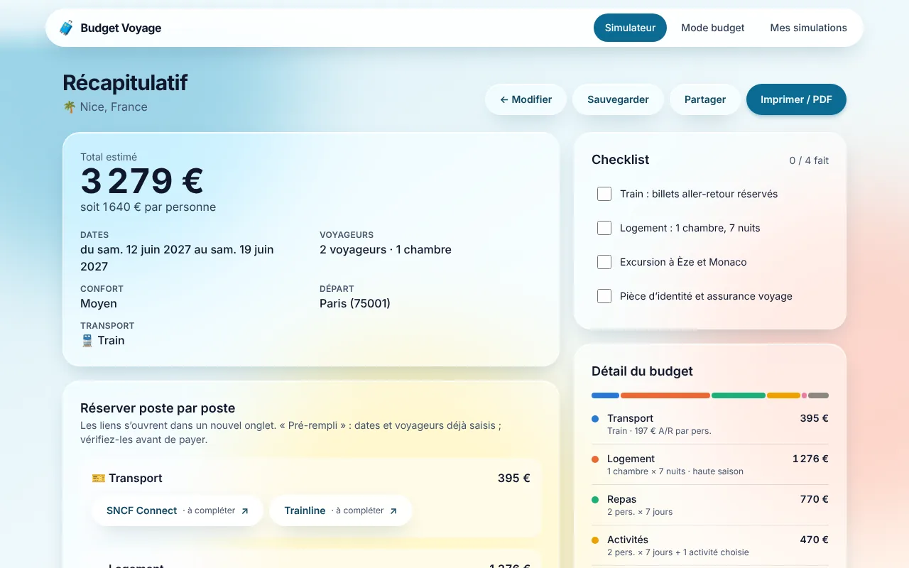
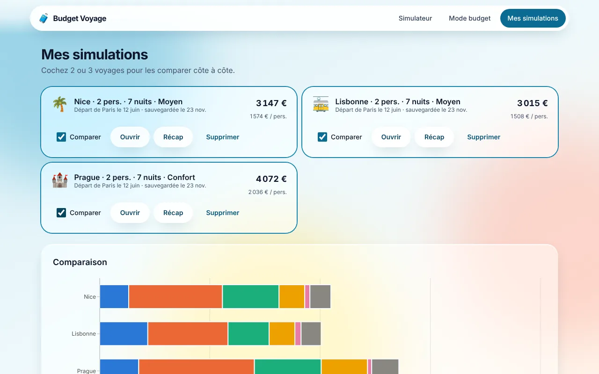
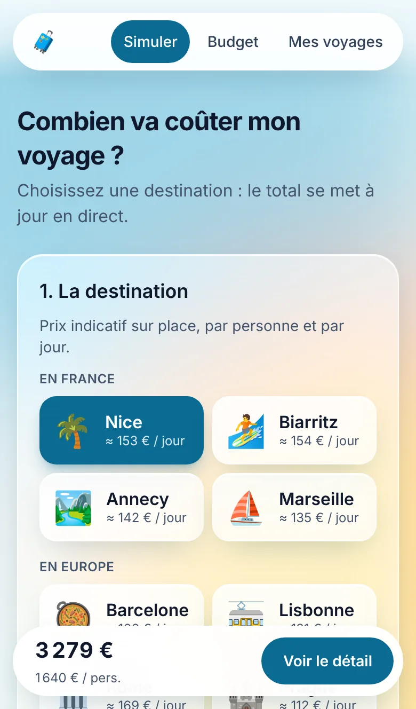
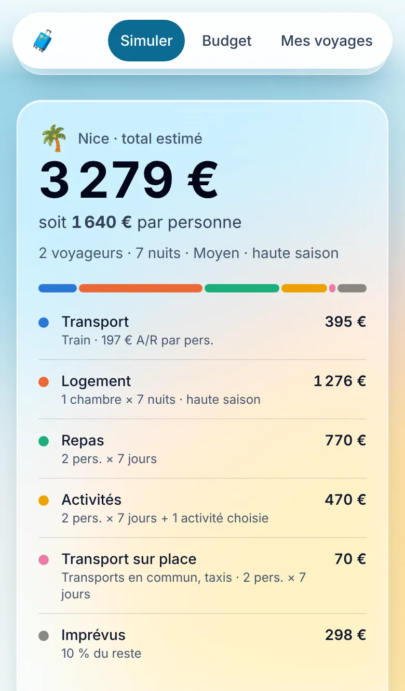
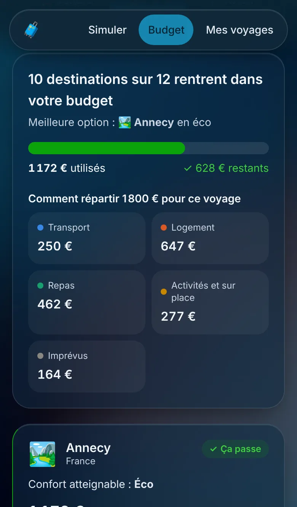

# 🧳 Budget Voyage

Simulateur de coût de vacances. On choisit une destination, le nombre de voyageurs, la durée, le niveau de confort et sa ville de départ (n'importe quelle commune de France). L'application calcule le coût du voyage poste par poste, en direct. Le **mode budget** fait l'inverse : on indique une somme, il montre les destinations qui rentrent dedans et donne des liens prêts pour réserver.

**Site en ligne : https://santinlivio9-hub.github.io/Vacances-app/**

- Interface en français, montants en euros, pensée pour le téléphone, avec un mode sombre automatique.
- Tout tourne dans le navigateur : pas de serveur, pas de clé d'API, pas de compte. Les simulations sauvegardées restent sur l'appareil.
- Les prix sont des **estimations moyennes constatées en 2026**, pas des devis. Sources et méthode : [src/data/SOURCES.md](src/data/SOURCES.md).

## Captures d'écran

| Accueil | Simulateur |
| --- | --- |
|  |  |
| **Mode budget** | **Récap et réservation** |
|  |  |
| **Comparaison de simulations** | |
|  | |

Sur téléphone :

| Simulateur | Résultat | Mode budget (sombre) |
| --- | --- | --- |
|  |  |  |

## Fonctionnalités

| Écran | Adresse | Ce qu'on y fait |
| --- | --- | --- |
| Accueil | `#/` | Choisir entre « Combien va coûter mon voyage ? » et « J'ai un budget, où partir ? » |
| Simulateur | `#/simulateur?…` | Destination, voyageurs, dates, confort, départ, transport ; « Plus d'options » (saison, imprévus, chambres). Total en direct, détail par poste, activités à cocher |
| Mode budget | `#/budget?…` | Budget, jauge, enveloppes conseillées, destinations en vert / orange / rouge avec le confort atteignable |
| Récap | `#/recap?…` | Liens de réservation pré-remplis, checklist, Sauvegarder / Partager / Imprimer-PDF |
| Mes simulations | `#/simulations` | Voyages sauvegardés, comparaison côte à côte de 2 ou 3 voyages |

Toute la simulation est dans l'adresse de la page : un lien partagé rouvre exactement le même voyage.

## Lancer en local

Il faut [Node.js](https://nodejs.org) 22 ou plus.

```bash
npm install
npm run dev      # puis ouvrir http://localhost:5173/Vacances-app/
npm test         # tests du moteur de calcul, des données et des utilitaires
npm run build    # version de production dans dist/
npm run preview  # sert dist/ en local pour vérifier la version de production
```

## Déployer sur GitHub Pages

Le déploiement est automatique : le workflow [.github/workflows/deploy.yml](.github/workflows/deploy.yml) se lance à chaque push sur `main`. Il fait `npm ci`, `npm test`, `npm run build`, puis publie `dist/`. Si les tests échouent, rien n'est publié.

Réglages à faire **une seule fois** :

1. Le dépôt doit être **public** (GitHub Pages gratuit) : Settings → General → Danger Zone → Change visibility.
2. Ouvrir **Settings → Pages**.
3. Dans **Build and deployment**, choisir **Source : GitHub Actions**.
4. Aller dans l'onglet **Actions**, ouvrir le dernier « Déploiement GitHub Pages » et cliquer **Re-run all jobs**, ou pousser un nouveau commit sur `main`.
5. Une à deux minutes plus tard, le site est en ligne à `https://<utilisateur>.github.io/<nom-du-dépôt>/`.

Si le dépôt change de nom, il faut aussi modifier `base` dans [vite.config.ts](vite.config.ts) : `base: '/<nom-du-dépôt>/'`.

## Règles de calcul (`src/engine/`)

- **Logement** : une chambre pour deux voyageurs (`ceil(personnes / 2)`) × nuits × prix de la nuit × coefficient de saison.
- **Repas, activités, transport sur place** : par personne et par jour, avec un jour par nuit. Les jours d'arrivée et de départ sont en partie pris par le trajet.
- **Activités cochées** : prix indicatif × nombre de voyageurs.
- **Transport**, toujours en aller-retour :
  - voiture : une voiture pour 4, carburant et péages au km ;
  - train : prix au km par personne, avec un minimum et un plafond ;
  - avion : forfait plus un barème dégressif, majoré en haute saison. Le vol part de l'aéroport le plus proche, et le trajet jusqu'à l'aéroport est compté s'il dépasse 30 km.
  - Distances : vol d'oiseau, × 1,2 pour la route et le rail.
- **Mode impossible** (voiture pour New York, avion sous 300 km…) : le calcul bascule sur le mode possible le moins cher et le signale.
- **Saison** : déduite du mois de départ, ou choisie à la main.
- **Imprévus** : 10 % du sous-total par défaut, réglable de 0 à 30 %.
- **Mode budget** :
  - les imprévus sont mis de côté, puis le transport reçoit son coût réel ;
  - le reste est réparti en 35 / 25 / 15 entre logement, repas et activités ;
  - pour chaque destination, on retient le meilleur confort qui tient dans le budget : vert s'il reste au moins 10 % de marge, orange entre 0 et 10 %, rouge si le budget est dépassé.

## Stack et organisation

Vite, React, TypeScript, Tailwind CSS, Recharts et Vitest.

```
src/
  data/       données JSON versionnées (destinations, transports, communes, aéroports) + SOURCES.md
  engine/     moteur de calcul : fonctions pures, testées, sans interface
  pages/      les cinq écrans
  components/ composants d'interface
  hooks/      navigation, montants animés, messages
  lib/        paramètres d'URL, sauvegarde locale, formatage, libellés
scripts/      régénération de la liste des communes (npm run donnees:communes)
docs/         captures d'écran
```

- **Navigation par `#/…`** : GitHub Pages ne sait pas servir les autres adresses d'une application d'une seule page.
- **Liste des communes** : environ 285 Ko compressés, téléchargés seulement à la première recherche d'une ville.

## Évolutions prévues

L'architecture est prête pour :

- **des prix réels** via les programmes d'affiliation (Booking, Skyscanner, GetYourGuide) ou un petit backend. Il suffirait de remplacer les barèmes de `src/data/` en gardant les mêmes fonctions du moteur ;
- **un assistant IA** qui propose un itinéraire jour par jour dans le budget, via un backend séparé qui garde la clé d'API ;
- **plus de destinations et de devises** : ajouter une entrée à `destinations.json` suffit, les tests vérifient sa cohérence.
