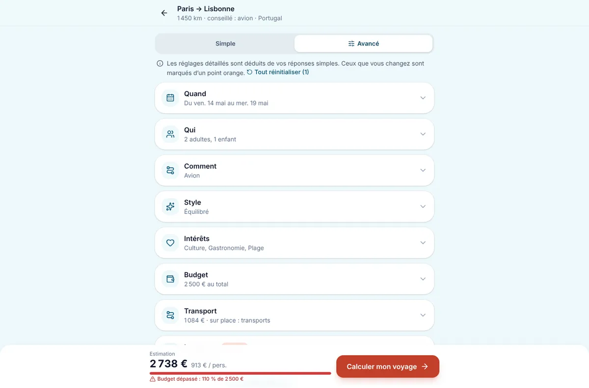
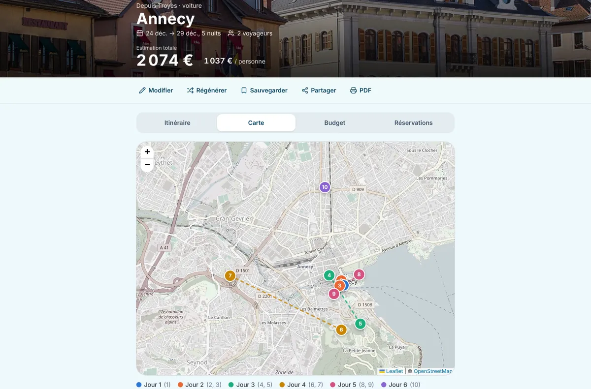
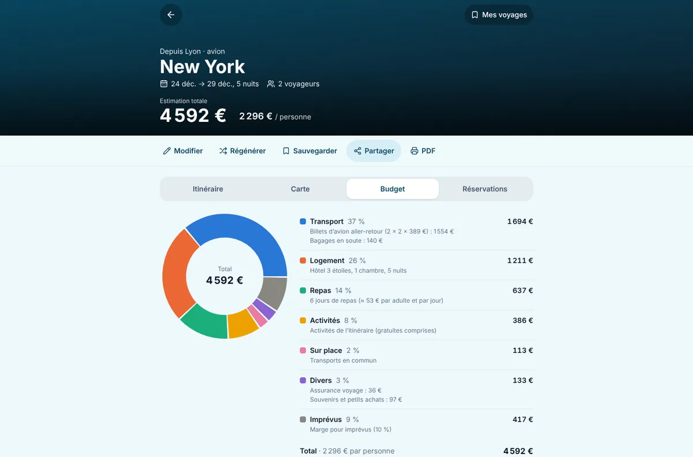
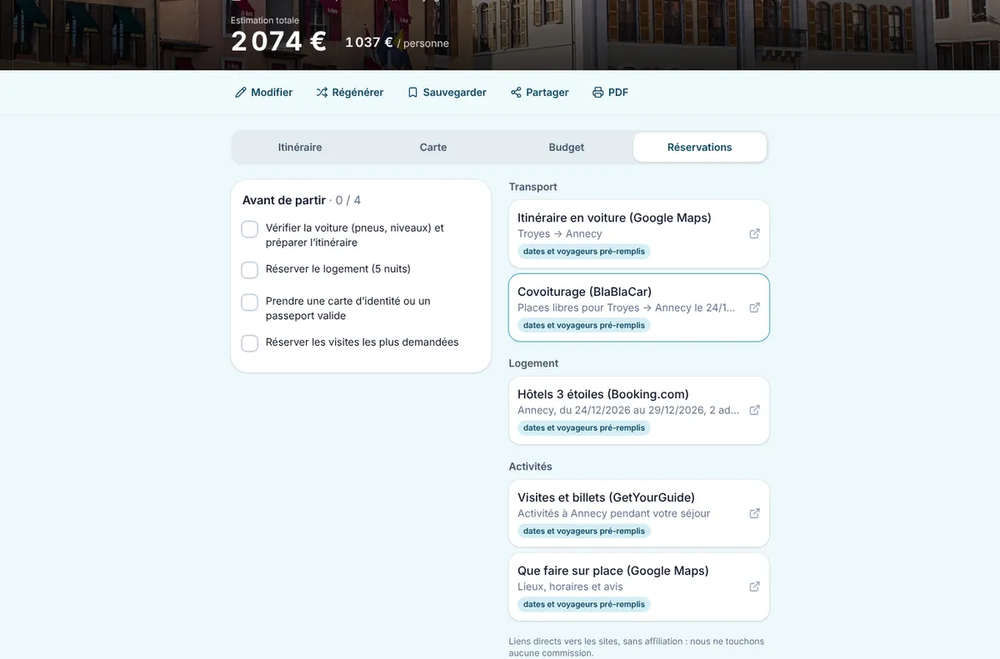
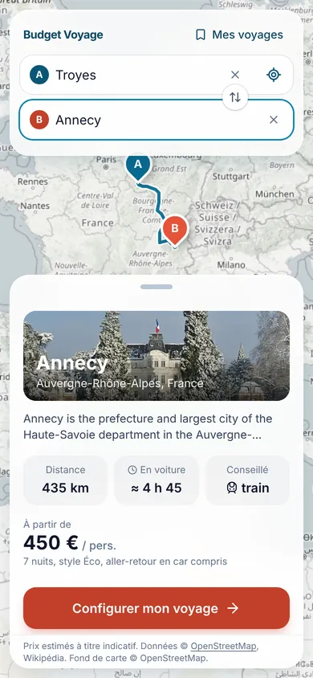
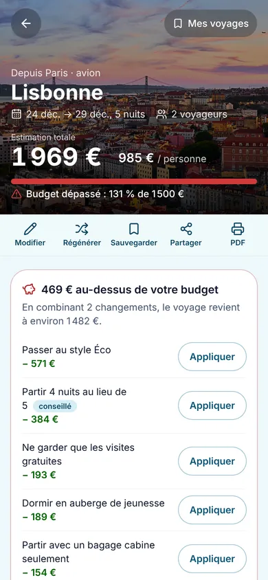
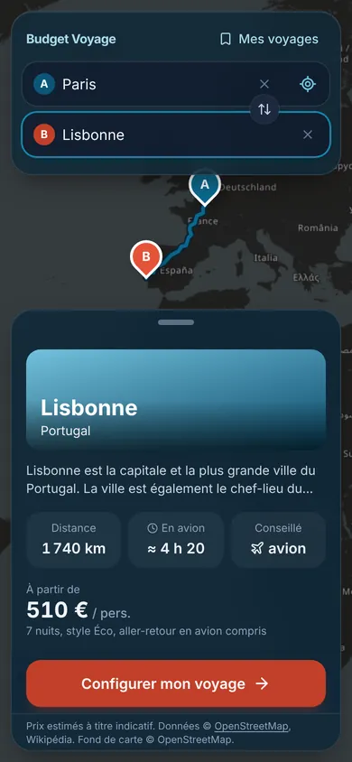

# 🧳 Budget Voyage

Préparez un voyage comme sur une carte en ligne : on choisit un départ et une arrivée, on règle son voyage (simplement ou en détail), et l'application calcule le budget poste par poste, construit un itinéraire jour par jour et donne les liens pour réserver.

**Site en ligne : https://santinlivio9-hub.github.io/Vacances-app/**

- N'importe quelle destination dans le monde : une ville, une adresse, ou un point touché sur la carte.
- Tout tourne dans le navigateur : pas de serveur, pas de clé d'API, pas de compte. Les voyages sauvegardés restent sur l'appareil.
- Interface en français, montants en euros, pensée pour le téléphone, avec un mode sombre automatique.
- Les prix sont des **estimations**, pas des devis. Méthode et sources : [src/data/SOURCES.md](src/data/SOURCES.md).

## Captures d'écran

| Carte | Configuration (mode Avancé) |
| --- | --- |
|  |  |
| **Mon voyage : itinéraire** | **Carte du séjour** |
|  |  |
| **Budget** | **Réservations** |
|  |  |

Sur téléphone :

| Carte | Mon voyage (budget dépassé) | Mode sombre |
| --- | --- | --- |
|  |  |  |

## Le parcours

| Écran | Adresse | Ce qu'on y fait |
| --- | --- | --- |
| Carte | `#/` | Champs Départ et Arrivée avec suggestions, toucher la carte (« Partir d'ici / Aller ici »), « Ma position ». Tracé de la route ou arc d'avion, distance, durée, mode conseillé, prix « à partir de », photo et résumé Wikipédia. Destinations populaires si l'arrivée est vide. |
| Configuration | `#/configurer` | Mode **Simple** : quand, qui, comment (prix et durée de chaque mode), style, intérêts, budget. Mode **Avancé** : transport, logement, repas, activités, budget et divers. Les réglages avancés sont déduits du mode Simple ; ceux qu'on change sont marqués et se réinitialisent un par un. Estimation en direct dans la barre du bas. |
| Chargement | `#/calcul` | Les étapes se cochent : trajet, lieux à visiter, prix, itinéraire, liens. |
| Mon voyage | `#/voyage` | Total, prix par personne, jauge du budget ; économies chiffrées si le budget est dépassé. Onglets Itinéraire, Carte, Budget, Réservations. Modifier, Régénérer, Sauvegarder, Partager par lien, Imprimer / PDF. |
| Mes voyages | `#/mes-voyages` | Voyages sauvegardés : rouvrir ou supprimer. |
| Partage | `#/partage?v=…` | Un lien partagé contient le trajet, les réglages et la graine de l'itinéraire : il rouvre exactement le même voyage. |

## Services utilisés (gratuits, sans clé)

Chaque service a un repli : l'application fonctionne même quand l'un d'eux ne répond pas. Les réponses sont gardées en cache pendant la session.

| Service | Usage | Si ça ne répond pas |
| --- | --- | --- |
| [Photon](https://photon.komoot.io) | Suggestions d'adresses | Communes françaises embarquées |
| [Nominatim](https://nominatim.org) | Adresse d'un point touché ; recherche après validation (1 requête/s, jamais en autocomplétion) | Coordonnées affichées |
| [OSRM](https://project-osrm.org) | Route en voiture : tracé, distance, durée | Vol d'oiseau × 1,25 |
| [Overpass](https://overpass-api.de) (OpenStreetMap) | Lieux à visiter autour de la destination | Articles Wikipédia proches, puis programme type |
| [Wikipédia](https://fr.wikipedia.org) | Photos et résumés | Dégradé de couleur, sans texte |
| [OpenStreetMap](https://www.openstreetmap.org/copyright) | Fond de carte | — |

Le fond CARTO prévu au départ exige une clé depuis septembre 2026 : la carte utilise donc les tuiles OpenStreetMap, adoucies par un filtre.

## Lancer en local

Il faut [Node.js](https://nodejs.org) 22 ou plus.

```bash
npm install
npm run dev      # puis ouvrir http://localhost:5173/Vacances-app/
npm test         # tests du moteur, des données, des services (réseau simulé) et du store
npm run build    # version de production dans dist/
npm run preview  # sert dist/ en local
```

## Déploiement

Le workflow [.github/workflows/deploy.yml](.github/workflows/deploy.yml) se lance à chaque push sur `main` : `npm ci`, `npm test`, `npm run build`, puis publication de `dist/` sur GitHub Pages. Si un test échoue, rien n'est publié.

Réglages à faire une seule fois : dépôt public, puis **Settings → Pages → Source : GitHub Actions**. Si le dépôt change de nom, modifier aussi `base` dans [vite.config.ts](vite.config.ts).

## Le moteur de calcul (`src/engine/`)

Fonctions pures, sans interface, toutes testées.

- **Coûts** (`couts.ts`) : prix de référence France × indice du pays (78 pays, moyenne régionale sinon) × saison. Enfants à 70 % pour repas, activités et souvenirs, 100 % pour le transport et le logement. Marge pour imprévus réglable.
- **Transport** (`transport.ts`) : voiture (carburant et péages, partagés par véhicule), train et car (prix au km avec minimum et plafond), avion (forfait + barème dégressif, saison, classe, bagages, trajet jusqu'à l'aéroport). Un mode irréaliste est refusé avec sa raison (pas de route, trop long, vol de moins de 400 km).
- **Budget** (`budget.ts`) : chaque piste d'économie est chiffrée en relançant l'estimation ; le plan proposé est le plus court qui tient le budget, en commençant par des économies ciblées.
- **Itinéraire** (`itineraire.ts`) : lieux notés selon les intérêts, leur notoriété et la distance, regroupés par k-moyennes (un quartier par jour), premier et dernier jour allégés, horaires indicatifs. Même graine, même itinéraire ; « Régénérer » change la graine.
- **Réservations** (`liens.ts`) : liens pré-remplis quand le site l'accepte (Booking.com, Airbnb, BlaBlaCar, Google Vols, Google Maps, GetYourGuide), checklist avant le départ, formalités indicatives. Aucun lien d'affiliation.
- **Partage** (`partage.ts`) : voyage encodé dans l'adresse, vérifié à l'ouverture.

## Organisation

```
src/
  domain/    types partagés
  data/      données JSON (pays, prix de référence, barèmes, communes, aéroports) + SOURCES.md
  engine/    moteur de calcul (fonctions pures, testées)
  services/  un fichier par service en ligne, avec cache et replis
  store/     état du voyage (zustand, sauvegardé dans le navigateur)
  carte/     écran Carte (Leaflet chargé à la demande)
  config/    écran Configuration
  voyage/    écrans Chargement et Mon voyage (Recharts chargé à la demande)
  pages/     les écrans
  ui/        petits composants et formatage
scripts/     régénération de la liste des communes (npm run donnees:communes)
docs/        captures d'écran
```

Stack : Vite, React, TypeScript, Tailwind CSS, react-router, zustand, Leaflet, Recharts, framer-motion, lucide-react, Vitest.

---

Prix estimés à titre indicatif. Données © [OpenStreetMap](https://www.openstreetmap.org/copyright) (ODbL), Wikipédia (CC BY-SA).
