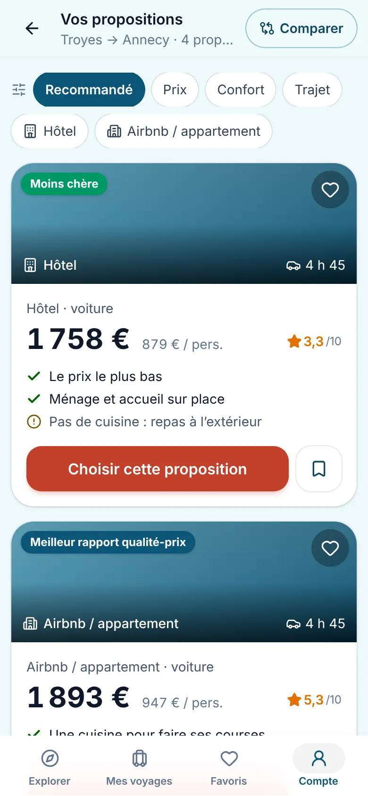
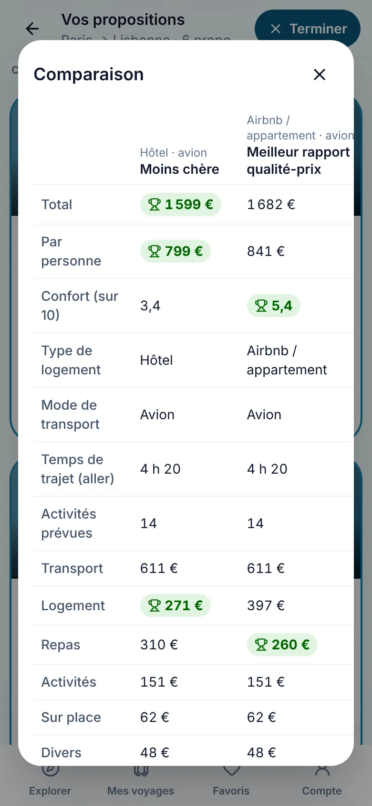
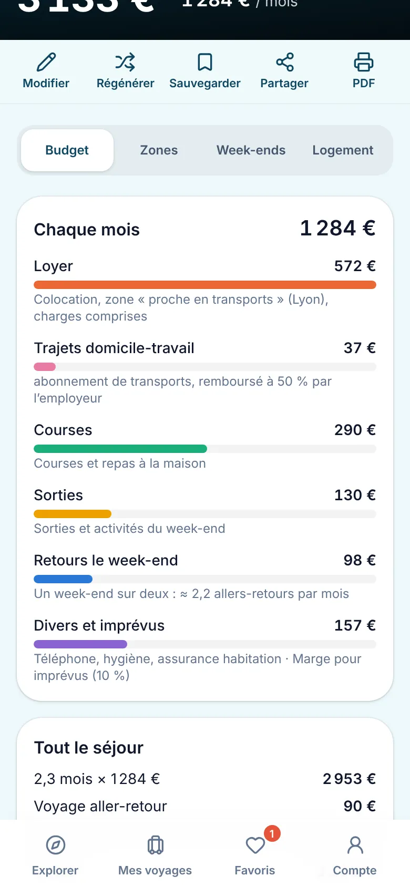
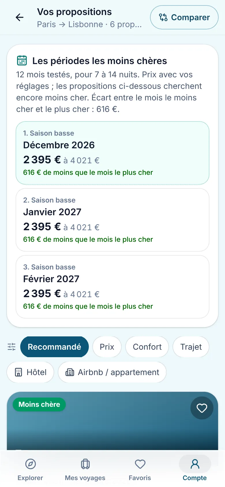
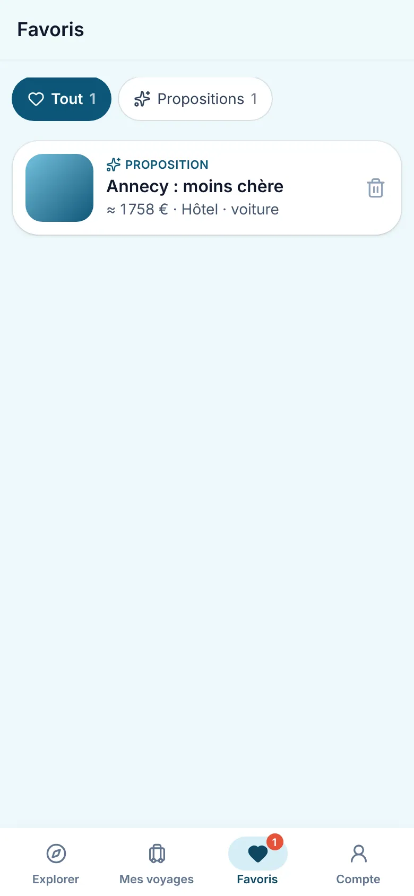
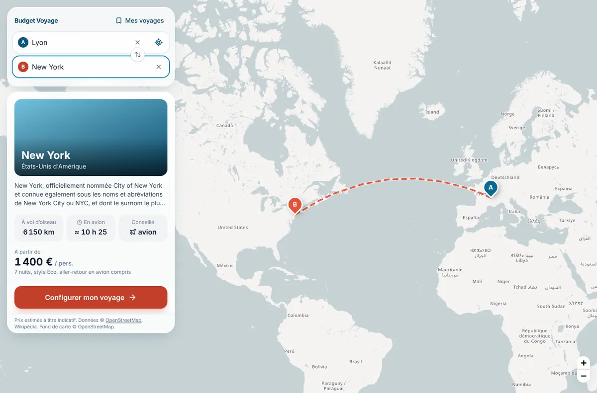
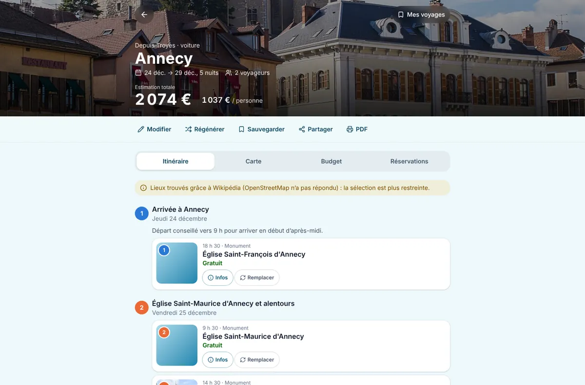

# 🧳 Valise & Cap

Préparez un voyage comme sur une carte en ligne : on choisit un départ et une arrivée, le type de voyage (vacances, dates flexibles, week-end, stage), on règle les détails, et l'application compare plusieurs propositions chiffrées poste par poste, avec l'itinéraire jour par jour (ou le budget par mois pour un stage) et les liens pour réserver.

**Site en ligne : https://santinlivio9-hub.github.io/Vacances-app/**

- N'importe quelle destination dans le monde : une ville, une adresse, ou un point touché sur la carte.
- Tout tourne dans le navigateur, sans compte obligatoire : les voyages et favoris restent sur l'appareil. Un compte (facultatif, Supabase) permet de les retrouver partout.
- Interface en français, montants en euros, pensée pour le téléphone, thème clair, sombre ou automatique.
- Les prix sont des **estimations**, pas des devis. Méthode et sources : [src/data/SOURCES.md](src/data/SOURCES.md).

## Captures d'écran

| Vos propositions | Comparaison | Stage : budget par mois |
| --- | --- | --- |
|  |  |  |
| **Type de voyage** | **Dates flexibles** | **Favoris** |
|  |  |  |

| Carte (ordinateur) | Mon voyage : itinéraire |
| --- | --- |
|  |  |

## Le parcours

La barre d'onglets (en bas sur téléphone, à gauche sur ordinateur) donne accès à **Explorer**, **Mes voyages**, **Favoris** et **Compte**. Elle se cache pendant la configuration et le calcul.

| Écran | Adresse | Ce qu'on y fait |
| --- | --- | --- |
| Explorer | `#/` | Départ et arrivée avec suggestions, toucher la carte, « Ma position ». Tracé, distance, durée, mode conseillé, prix « à partir de », photo et résumé Wikipédia. Destinations populaires avec un cœur pour les mettre en favori. |
| Configuration | `#/configurer` | D'abord le **type de voyage** (grandes cartes), puis les questions de ce type en mode **Simple** ou **Avancé**. Types de logement à cocher (plusieurs possibles). Estimation en direct en bas. |
| Calcul | `#/calcul` | Les étapes se cochent : trajet, lieux, prix, itinéraire ou zones, propositions. |
| Vos propositions | `#/propositions` | 3 à 6 propositions avec badge (« Moins chère », « Meilleur rapport qualité-prix », « La plus confortable », « La plus rapide » ou « La plus proche du travail », « Vos réglages », « Version Airbnb »…), écart au budget, points forts et faibles. Tris, filtre par logement, mode **Comparer** (2 ou 3 côte à côte, meilleures valeurs en vert). |
| Mon voyage | `#/voyage` | La proposition choisie : itinéraire, carte, budget, réservations (ou, pour un stage : budget par mois, zones de logement, week-ends, logement). Retour aux propositions à tout moment. |
| Mes voyages | `#/mes-voyages` | Voyages rangés en « À venir », « Brouillons » (configurés, pas calculés) et « Passés ». |
| Favoris | `#/favoris` | Destinations, propositions, logements et activités mis en favori. |
| Compte | `#/compte` | Connexion, préférences par défaut (ville de départ, voyageurs, style, logements, intérêts, mode Simple ou Avancé), thème, export JSON, suppression. |
| Partage | `#/partage?v=…` | Un lien partagé rouvre exactement le même voyage. |

## Les types de voyage (`src/tripTypes/`)

Un fichier par type déclare ses questions Simple et Avancé, ses logements possibles, ses valeurs par défaut et sa façon de calculer. Pour ajouter un type, créer un fichier qui exporte une `DefinitionTypeVoyage` puis l'ajouter à `TYPES_VOYAGE` dans [src/tripTypes/index.ts](src/tripTypes/index.ts).

| Type | Dates | Calcul |
| --- | --- | --- |
| Vacances | dates fixes | itinéraire jour par jour |
| Dates flexibles | durée souple (ex. 7 à 14 nuits), période ou « peu importe » | 12 mois testés, les 3 moins chers proposés avec l'écart de prix |
| Week-end | 1 ou 2 nuits | trajets de plus de 6 h écartés, programme serré |
| Stage / séjour long | début et fin, jours travaillés, horaires, trajet maximum, retours le week-end, gratification | dépenses par mois + frais ponctuels, gratification (minimum légal 4,50 €/h en 2026) et reste à charge, dépôt de garantie à part, zones de logement autour du lieu de travail |

## Activer les comptes (Supabase, gratuit)

Sans cette étape, le site marche entièrement en mode invité. Avec, on peut se connecter par **lien magique** (e-mail) ou **Google** et retrouver ses voyages, favoris et préférences sur tous ses appareils. À la première connexion, l'app propose d'importer les données déjà présentes sur l'appareil.

1. **Créer le projet.** Sur [supabase.com](https://supabase.com), créez un compte puis **New project** (offre gratuite). Choisissez une région proche, par exemple *West EU (Paris)*, et notez le mot de passe de la base (il ne sert pas à l'app).
2. **Créer les tables.** Menu **SQL Editor** → **New query**, collez le contenu de [supabase/schema.sql](supabase/schema.sql), puis **Run**. Le script crée les tables `profils`, `voyages` et `favoris`, les règles **RLS** (chacun ne voit que ses données) et la fonction qui permet de supprimer son compte. On peut le relancer sans risque.
3. **Adresses autorisées.** **Authentication** → **URL Configuration** :
   - *Site URL* : `https://santinlivio9-hub.github.io/Vacances-app/`
   - *Redirect URLs* : ajoutez la même adresse, et `http://localhost:5173/Vacances-app/` pour travailler en local.
4. **Lien magique.** **Authentication** → **Sign In / Providers** → **Email** : vérifiez qu'il est activé (il l'est par défaut). Le service d'e-mail intégré de Supabase n'envoie que quelques e-mails par heure : pour un usage réel, branchez votre propre SMTP (**Authentication** → **Emails** → **SMTP Settings**).
5. **Google.**
   - Dans la [console Google Cloud](https://console.cloud.google.com/apis/credentials), créez un projet, configurez l'écran de consentement OAuth (type « Externe »), puis **Créer des identifiants** → **ID client OAuth** → **Application Web**.
   - *URI de redirection autorisés* : `https://VOTRE-PROJET.supabase.co/auth/v1/callback` (l'adresse exacte est affichée dans Supabase, sur la page du fournisseur Google).
   - Copiez l'ID client et le code secret dans Supabase : **Authentication** → **Sign In / Providers** → **Google** → activez, collez, enregistrez.
6. **Récupérer l'URL et la clé.** **Project Settings** → **API Keys** (ou **Data API**) : copiez l'**URL du projet** et la clé **anon** (ou *publishable*). Cette clé est faite pour être publique : la sécurité vient des règles RLS. Ne copiez jamais la clé *service_role* (ou *secret*).
7. **Secrets GitHub.** Dans le dépôt : **Settings** → **Secrets and variables** → **Actions** → **New repository secret**, deux fois :
   - `VITE_SUPABASE_URL` = l'URL du projet ;
   - `VITE_SUPABASE_ANON_KEY` = la clé anon.
8. **Republier.** **Actions** → **Déployer sur GitHub Pages** → **Run workflow** (ou poussez un commit sur `main`). L'onglet Compte propose alors la connexion.

En local : copiez `.env.example` en `.env`, remplissez les deux valeurs, puis `npm run dev`. Le fichier `.env` n'est jamais envoyé sur GitHub.

Bon à savoir : la connexion utilise le flux PKCE (le retour arrive en `?code=…`, compatible avec les adresses en `#/`). Le lien magique doit donc être ouvert **dans le même navigateur** que celui où on l'a demandé.

## Services utilisés (gratuits, sans clé)

Chaque service a un repli : l'application fonctionne même quand l'un d'eux ne répond pas. Les réponses sont gardées en cache pendant la session.

| Service | Usage | Si ça ne répond pas |
| --- | --- | --- |
| [Photon](https://photon.komoot.io) | Suggestions d'adresses | Communes françaises embarquées |
| [Nominatim](https://nominatim.org) | Adresse d'un point touché ; recherche après validation (1 requête/s, jamais en autocomplétion) | Coordonnées affichées |
| [OSRM](https://project-osrm.org) | Route en voiture : tracé, distance, durée | Vol d'oiseau × 1,25 |
| [Overpass](https://overpass-api.de) (OpenStreetMap) | Lieux à visiter autour de la destination | Articles Wikipédia proches, puis programme type |
| [Wikipédia](https://fr.wikipedia.org) | Photos et résumés | Dégradé de couleur, sans texte |
| [OpenStreetMap](https://www.openstreetmap.org/copyright) | Fond de carte | — |
| [Supabase](https://supabase.com) (facultatif) | Comptes et synchronisation | Mode invité |

## Lancer en local

Il faut [Node.js](https://nodejs.org) 22 ou plus.

```bash
npm install
npm run dev      # puis ouvrir http://localhost:5173/Vacances-app/
npm test         # tests du moteur, des données, des services (réseau simulé) et des stores
npm run test:mobile  # après npm run build : chaque écran en 390 px, sans défilement horizontal (Playwright)
npm run build    # version de production dans dist/
npm run preview  # sert dist/ en local
```

## Déploiement

Le workflow [.github/workflows/deploy.yml](.github/workflows/deploy.yml) se lance à chaque push sur `main` : `npm ci`, `npm test`, `npm run build` (avec les secrets Supabase s'ils existent), puis publication de `dist/` sur GitHub Pages. Si un test échoue, rien n'est publié.

Réglages à faire une seule fois : dépôt public, puis **Settings → Pages → Source : GitHub Actions**. Si le dépôt change de nom, modifier aussi `base` dans [vite.config.ts](vite.config.ts).

## Trajets combinés et prix (v5)

- **Comparatif des trajets** : voiture, covoiturage, autocar (FlixBus), train, voiture + train, train + transport local, avion, voiture + avion. Chaque trajet est une suite d'étapes, avec une durée, une fourchette de prix et un lien par étape (badge « pré-rempli » seulement si le lien transmet vraiment les dates et les voyageurs).
- **Mode simple** : moins cher, plus rapide ou compromis, et un interrupteur pour les trajets combinés. **Mode avancé** : temps de route jusqu'à la gare ou l'aéroport, parking ou dépose, carte Avantage ou Avantage Jeune, réservation tôt, normale ou à la dernière minute, usure de la voiture.
- **Prix** : tarifs SNCF officiels par paire de gares, carburant du jour (API officielle), péages sur la part autoroute, indices de prix de 60 villes, tarifs d'entrée OpenStreetMap. Chaque total est donné avec une fourchette : « 985 € (entre 810 et 1 210 €) ».
- Détail des sources et cas de contrôle : [`src/data/SOURCES.md`](src/data/SOURCES.md).

## Le moteur de calcul (`src/engine/`)

Fonctions pures, sans interface, toutes testées.

- **Coûts** (`couts.ts`) : prix de référence France × indice du pays (78 pays, moyenne régionale sinon) × saison. Neuf types de logement, frais de ménage et de service Airbnb, taxe de séjour ; avec une cuisine, les repas hors restaurant coûtent le prix des courses.
- **Transport** (`transport.ts`) : voiture, train, car, avion. Un mode irréaliste est refusé avec sa raison.
- **Propositions** (`propositions.ts`) : `genererPropositions` combine logements cochés, modes réalistes, style voisin, périodes ou zones, puis garde 3 à 6 propositions sans doublon, avec leurs badges, points forts et faibles.
- **Dates flexibles** (`periodes.ts`) : `meilleuresPeriodes` teste les mois possibles et garde les 3 moins chers.
- **Séjour long** (`sejourLong.ts`) : `budgetSejourLong` donne le budget par mois, les zones autour du lieu de travail et le coût des trajets domicile-travail.
- **Budget** (`budget.ts`) : pistes d'économie chiffrées et plan le plus court pour tenir le budget.
- **Itinéraire** (`itineraire.ts`) : lieux notés selon les intérêts, regroupés par quartier, horaires indicatifs. Même graine, même itinéraire.
- **Réservations** (`liens.ts`) : liens pré-remplis quand le site l'accepte (un par type de logement coché ; Airbnb au mois, Leboncoin, Studapart, La Carte des Colocs pour un stage), checklist avant le départ. Aucun lien d'affiliation.
- **Partage** (`partage.ts`) : voyage encodé dans l'adresse, vérifié à l'ouverture.

## Organisation

```
src/
  domain/     types partagés
  data/       données JSON (pays, prix, barèmes, villes, communes, aéroports) + SOURCES.md
  engine/     moteur de calcul (fonctions pures, testées)
  tripTypes/  un fichier par type de voyage
  services/   un fichier par service en ligne, avec cache et replis
  store/      voyage, résultats, favoris, préférences (zustand, sauvegardés dans le navigateur)
  compte/     connexion Supabase, synchronisation, import et export des données
  carte/      écran Explorer (Leaflet chargé à la demande)
  config/     écran Configuration
  voyage/     propositions, comparaison, Mon voyage (Recharts chargé à la demande)
  pages/      les écrans
  ui/         barre d'onglets, thème, petits composants
supabase/     schema.sql (tables, règles RLS, suppression de compte)
docs/         captures d'écran
```

Stack : Vite, React, TypeScript, Tailwind CSS, react-router, zustand, Leaflet, Recharts, framer-motion, lucide-react, Supabase (facultatif), Vitest.

---

Prix estimés à titre indicatif. Données © [OpenStreetMap](https://www.openstreetmap.org/copyright) (ODbL), Wikipédia (CC BY-SA).
